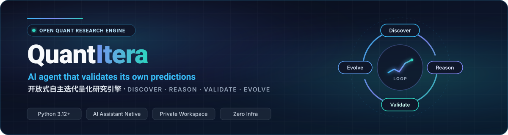
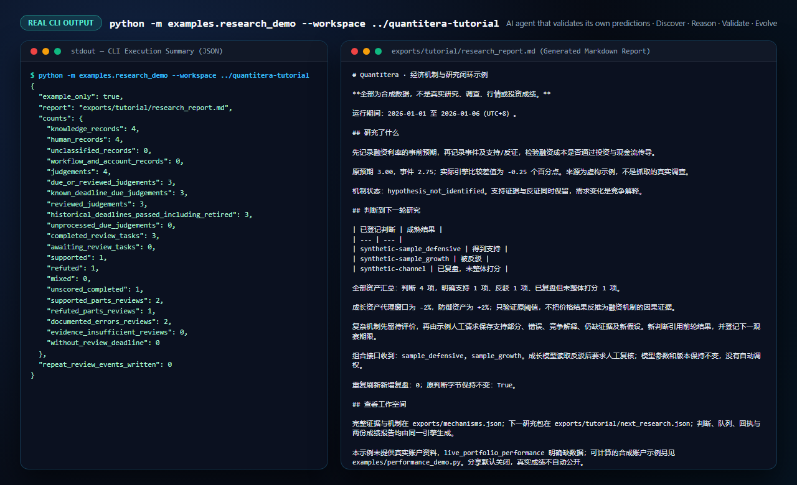

<div align="center">

<p><a href="README.md"><b>🇨🇳 中文</b></a> | <b>🇺🇸 English</b></p>



<h3>AI agent that validates its own predictions · Open Autonomous Iterative Quant Research Engine</h3>
<p><b>Discover. Reason. Validate. Evolve.</b></p>

[](https://colab.research.google.com/github/wysking/quantitera/blob/main/demo.ipynb)
[](LICENSE)
[](pyproject.toml)
[](https://github.com/wysking/quantitera/actions/workflows/ci.yml)
[](https://github.com/wysking/quantitera/releases)

<p><b>💡 The Pain Point: 99% of AI research assistants and backtest scripts only generate opinions — they never keep an immutable ledger or check whether their past predictions actually came true at maturity. QuantItera closes the loop from timestamped judgements to automated outcome validation and reusable feedback.</b></p>



</div>

### ⚡ Run the Full Closed Loop in 3 Lines (No API Key Needed)

```sh
git clone https://github.com/wysking/quantitera.git && cd quantitera
python -m pip install -e .
python -m examples.research_demo --workspace ../quantitera-tutorial
```

> ⭐ **If an open-source research engine that validates its own predictions at maturity resonates with you, please give us a Star in the top-right corner!**
> The full architecture, capability matrix, and 10-step walkthrough are available in the **[Full Technical Guide (docs/overview.en.md)](docs/overview.en.md)**.

---

## 🧩 QuantItera at a Glance

| Stage | Core Action | What It Solves |
| :--- | :--- | :--- |
| **1. Discover** | Record primary events, prior expectations, and mechanism evidence | Preserves publication vs. first-availability timestamps to prevent hindsight bias |
| **2. Reason** | Evaluate competing explanations and call private asset/portfolio models | Grounds reasoning in falsifiable hypotheses and archives structured judgements with `review_at` |
| **3. Validate** | Automatically verify mature trading windows or queue human/AI review | Scores `supported` / `refuted` objectively while preserving evidence gaps on complex mechanisms |
| **4. Evolve** | Inject historical refutations and lessons into every `discuss` and model run | Compounds research memory across iterations and generates dual research & live TWR reports |

## 🤖 Dual-Track AI Integration (ChatGPT & Gemini Google-Native Bridge)

QuantItera ships with two production-tested AI integration routes, complete with copy-ready prompts and bridge source code (see **[Dual-Track AI Integration & Google-Native Bridge Guide (docs/ai-integration.en.md)](docs/ai-integration.en.md)**):

| Route | Target AI Assistant | Read / Write Pipeline | Highlight |
| :--- | :--- | :--- | :--- |
| **Route A: GitHub Plugin / Remote MCP** | **ChatGPT** (Projects + Tasks), Claude, Cursor | Reads `AI_WORKFLOW.md` & `exports/*.json` directly; writes structured requests to `inbox/<id>.json` | Minimal setup for desktop and GitHub-connected clients |
| **Route B: Google-Native Bridge ⭐** | **Gemini** (Skills / Gems + Scheduled Tasks) | `@Google Drive` reads 4 read-only mirror Docs + `@Gmail` creates `[QUANT-INBOX]` drafts ⇄ **[Google Apps Script (`google_bridge/Code.gs`)](google_bridge/Code.gs)** validates schemas every 5 min and syncs with GitHub | **100% first-party Google connectors** — eliminates remote MCP drops, 7-day OAuth expiry, and background scheduled task write failures |

## 📚 Documentation & Sample Reports

- 📖 **[Full Technical Guide (EN)](docs/overview.en.md)** · **[完整技术指南（中文详版）](docs/overview.md)**
- 🤖 **[Dual-Track AI & Google Bridge Guide (EN)](docs/ai-integration.en.md)** · **[双轨 AI 接入与全谷歌原生桥接指南](docs/ai-integration.md)** · **[Apps Script Bridge Source (`google_bridge/`)](google_bridge/Code.gs)**
- 🚀 **[10-Step Getting Started Guide](docs/getting-started.md)** — Initialize a blank private workspace, load market data, and archive judgements
- 🏗️ **[Architecture Guide](docs/architecture.md)** · **[Research Methodology](docs/research-method.md)**
- 🔌 **[Private Model Interface (`provider`)](docs/providers.md)** · **[Automated GitHub Actions Refresh](docs/automation.md)**
- 📊 **[Performance Reporting Rules](docs/performance.md)** — Browse real generated outputs: [Closed-Loop Research Report](examples/research/research_report.md), [Research Track Record](examples/research/research_performance.md), and [Live Portfolio TWR Report](examples/performance/live_portfolio_performance.md)
- 📦 **[v0.5.0 Release Notes](docs/release-v0.5.0.md)** · **[Changelog](CHANGELOG.md)** · **[Contributing](CONTRIBUTING.md)** · **[Provenance & Boundaries](docs/reuse.md)**

<div align="center">

---

Released under the [MIT License](LICENSE) · **Discover. Reason. Validate. Evolve.**

</div>
