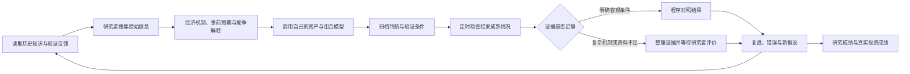

# QuantItera

**开放式自主迭代量化研究引擎**

**Discover. Reason. Validate. Evolve.**

An open research engine connecting economic hypotheses, timestamped judgements, mature outcome checks, and reusable feedback. Keep your data, models and accounts in your own workspace.

QuantItera 把经济机制研究、事前判断、到期验证和历史经验连成一个持续积累的研究过程。它是 Python 开源引擎，也可以作为 ChatGPT 的研究工作空间：每次正式研究先读历史反馈，研究者形成判断后以结构化请求归档，程序在结果成熟时验证明确条件，再把支持、反驳、错误和证据缺口送回下一轮研究。

“自主迭代”包含自动到期检查、客观验证、知识整理和报告更新。最新信息搜集、经济机制推理和复杂因果评价仍由研究者或 ChatGPT 完成；引擎没有后台大模型、收费 API 或交易执行。

## 研究如何循环



普通回测回答某个规则在历史数据中的表现。QuantItera 还记录判断**在何时、基于什么证据提出，后来哪些部分得到支持或反驳，以及下一次研究是否取得这些反馈**。回测、前向代理观察、模型模拟和真实账户成绩分别保存；历史结果也不会自动成为因果结论或策略权重。

## 已实现的能力

| 能力 | 实际行为 |
| --- | --- |
| V6 经济机制探索 | 分开保存事件、事前预期和机制证据；保留时间、单位、修订、支持、反证、竞争解释及下一观察 |
| 判断归档与到期任务 | inbox 请求自动处理，追加不可覆盖事件，按 review_at 登记验证任务并生成回执 |
| 客观验证 | 同标的、币种、收益口径和完整窗口匹配后，验证收盘收益或点位阈值；缺数据继续待评价 |
| 复杂研究与政策 | 保存证据缺口和竞争解释，由研究者完成评价；政策核对约束，不按价格涨跌评分 |
| 知识反馈 | discuss 先推进到期检查，再返回本资产及 all 通用经验；旧观点被替代后，复盘经验仍可检索 |
| 统一模型接口 | 私人 provider 调用独立资产模型和用户级组合模型，显式传入研究反馈并检查反馈版本 |
| 研究成绩 | 按资产、期限和模型版本统计原判断、复盘、前向观察、机制与因子进度；未打分保持未打分 |
| 真实投资成绩 | 完整资料下处理外部资金流、分红、费用、汇率、TWR、风险和可比基准；缺失指标说明所需资料 |
| 空白工作空间与 Actions | 独立数据目录、ChatGPT 入口和串行定时模板；不带个人持仓、策略或默认模型 |

核心能力复用原 V6 / P1 实现，[来源与迁移边界](docs/reuse.md) 可以核对。完整模块关系见 [架构说明](docs/architecture.md)。

## 从空白开始

需要 Git 和 Python 3.12+。在自己的 Python 环境运行：

```sh
git clone --branch v0.5.0 https://github.com/wysking/quantitera.git
cd quantitera
python -m pip install -e .
python -m research_engine init --workspace ../my-research
python -m research_engine refresh --workspace ../my-research
python -m research_engine discuss --workspace ../my-research --asset my_asset
```

空白运行不会出现默认持仓、模型或研究结论。接下来按 [新用户使用指南](docs/getting-started.md) 添加自己的研究对象、行情、模型和判断。

两个可以直接运行的完整示例，目标目录须不存在或为空：

```sh
python -m examples.research_demo --workspace ../quantitera-tutorial
python -m examples.performance_demo --workspace ../quantitera-performance-demo
```

第一个示例从空白目录走过经济证据、两项市场判断、复杂机制评价、下一轮判断和资产/组合模型反馈。第二个示例演示带入金、出金及费用的账户收益计算。**两个示例的证据、行情和账户均为合成数据。**

## 查看研究与成绩示例

| 内容 | 可直接阅读 | 本地运行后的路径 |
| --- | --- | --- |
| 经济机制、验证与下一轮反馈 | [研究闭环示例](examples/research/research_report.md) / [结构化结果](examples/research/summary.json) | exports/tutorial/ |
| 长期研究成绩 | [研究成绩示例](examples/research/research_performance.md) | exports/research_performance.md / .json |
| 实际账户绩效的展示口径 | [合成账户报告](examples/performance/live_portfolio_performance.md) | exports/live_portfolio_performance.md / .json |
| 可选公开摘要 | [合成分享示例](examples/performance/shareable/live_portfolio_performance.md) | exports/shareable/ |

真实成绩只在个人工作空间生成。config/performance.json 的 sharing.research / sharing.live 默认关闭；未选择时摘要只显示未选择状态。选择后也仅生成允许字段的摘要文件，**没有自动发布动作**。公开引擎不需要账户明细。计算口径和缺失资料见 [成绩报告说明](docs/performance.md)。

## 个人工作空间与自己的模型

公开仓库保存通用引擎、空白模板、测试和合成示例。个人账户、资产模型、策略、组合、因子定义和研究成果由独立工作空间保存；已有系统可以保持原账本及运行方式，通过 provider 读取原资料和调用原模型。

```json
{"schema_version":1,"mechanisms":{},"provider":"my_models:provide"}
```

入口为 provide(workspace, clock, operation, **kwargs)。资产模型收到本资产及通用验证反馈；组合模型收到全部资产结果和缺失项。详细契约、已有系统接入和可选因子/成绩能力见 [模型与工作空间接口](docs/providers.md)。

每次 discuss 都从当前知识重新取反馈，所以历史不会只是留在文件里。研究者仍须说明反馈如何影响新判断；接口不自动修改模型参数，也不据样本收益宣布研究能力改善。

## 日常自动运行

把初始化目录保存到自己的**私有 GitHub 仓库** main 分支，模板内的 [.github/workflows/research.yml](research_engine/workspace_template/.github/workflows/research.yml) 使用标准 Ubuntu runner，串行处理请求、检查到期任务并保存报告。配置完成后不需要每天手动运行 Actions。

行情仍由自己的数据入口更新 inputs/market.json。数据尚未更新时，任务明确等待；复杂经济研究通过工作空间 CHATGPT_WORKFLOW.md 继续。默认分支、写入权限、调度时区和免费额度边界见 [自动刷新指南](docs/automation.md)。

## 开发与评估

```sh
python -m pip install -e '.[test]'
python -m pytest -q
```

CI 测试公开引擎，并从安装后的 wheel、空白 Git 仓库和复制出的示例验证完整使用流程，不需要私人仓库或密钥。复现记录、已有真实模型兼容性及待改进项见 [v0.5.0 验收与发布说明](docs/release-v0.5.0.md)。参与维护见 [CONTRIBUTING.md](CONTRIBUTING.md) 和 [CHANGELOG.md](CHANGELOG.md)。

当前交易日历登记到 2026 年；未知年份或标的明确拒绝，需要有来源的扩展。引擎没有内置行情抓取、通用回测器、默认因子库、自动策略调权或实盘下单。复杂机制的因果识别和可比研究能力评估仍需专门证据与研究设计。

[MIT License](LICENSE)。
