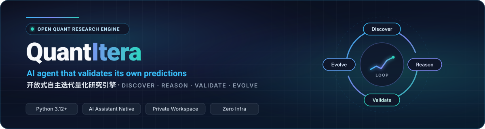
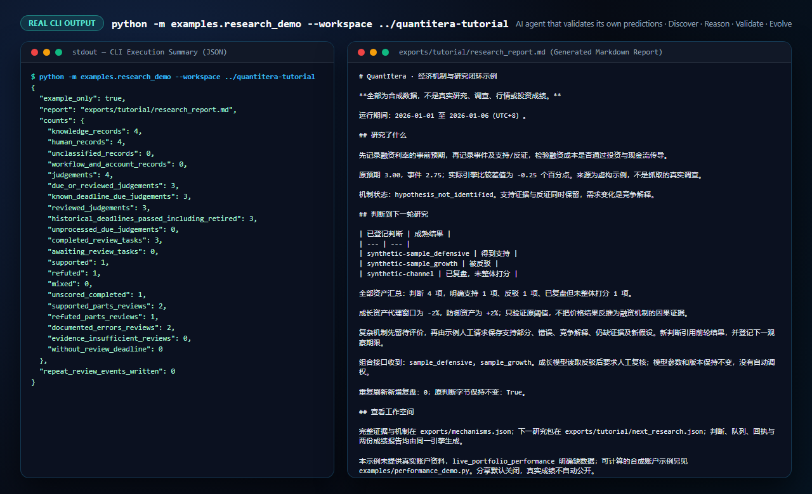

<div align="center">

<p><b>🇨🇳 中文</b> | <a href="README.en.md"><b>🇺🇸 English</b></a></p>



<h3>AI agent that validates its own predictions · 开放式自主迭代量化研究引擎</h3>
<p><b>Discover. Reason. Validate. Evolve.</b></p>

[](https://colab.research.google.com/github/wysking/quantitera/blob/main/demo.ipynb)
[](LICENSE)
[](pyproject.toml)
[](https://github.com/wysking/quantitera/actions/workflows/ci.yml)
[](https://github.com/wysking/quantitera/releases)

<p><b>💡 痛点：99% 的 AI 投研助手和回测脚本只管生成观点，从不记账，更不会在到期后验证自己当初说得对不对——QuantItera 把每一次事前判断、到期自动验证与复盘经验回流连成真正能自我进化的闭环。</b></p>



</div>

### ⚡ 3 行跑通完整闭环（无需 API Key）

```sh
git clone https://github.com/wysking/quantitera.git && cd quantitera
python -m pip install -e .
python -m examples.research_demo --workspace ../quantitera-tutorial
```

> ⭐ **如果这个「会到期验证自己判断」的开源量化研究引擎对你有启发，请点亮右上角 Star 支持项目持续迭代！**
> 完整架构、核心能力矩阵与 10 步教程已收纳至 **[《QuantItera 完整技术指南》(docs/overview.md)](docs/overview.md)**。

---

## 🧩 一眼看懂 QuantItera

| 阶段 | 核心动作 | 解决什么问题 |
| :--- | :--- | :--- |
| **1. Discover** | 记录原始事件、事前预期与机制证据 | 保留发布时间与首次获知边界，杜绝事后改写记忆 |
| **2. Reason** | 结合竞争解释，调用个人资产与组合模型 | 把推理建立在可证伪假设上，归档带 `review_at` 的结构化判断 |
| **3. Validate** | 到期自动对照完整交易窗口或触发人工/AI 复盘 | 自动判定 `supported` / `refuted`，复杂机制保留证据缺口 |
| **4. Evolve** | 每次 `discuss` 与模型调用自动注入历史反驳与教训 | 历史经验自动回流下一轮研究，同步输出研究成绩与实盘 TWR 绩效 |

## 🤖 双轨 AI 助手接入方案（ChatGPT & Gemini 全谷歌原生桥接）

QuantItera 原生内置两套 AI 助手接入路线，完整源码与可复制指令已随仓开源（详见 **[《双轨 AI 接入与全谷歌原生桥接指南》(docs/ai-integration.md)](docs/ai-integration.md)**）：

| 路线 | 适用 AI 助手 | 读写链路 | 核心特点 |
| :--- | :--- | :--- | :--- |
| **方案 A：GitHub 插件 / 远程 MCP** | **ChatGPT** (Projects + Tasks)、Claude、Cursor | 直接读取 `AI_WORKFLOW.md` 与 `exports/*.json`，向 `inbox/<id>.json` 提交请求 | 配置极简，适合桌面与支持 GitHub Connector 的环境 |
| **方案 B：全谷歌原生桥接 ⭐** | **Gemini** (Skills / Gems + Scheduled Tasks) | `@Google Drive` 读 4 份只读镜像 Docs + `@Gmail` 写 `[QUANT-INBOX]` 草稿 ⇄ **[Google Apps Script (`google_bridge/Code.gs`)](google_bridge/Code.gs)** 每 5 分钟离线 Schema 校验并同步 GitHub | **100% 谷歌第一方连接器**，彻底解决第三方 MCP 断连、7 天 OAuth 过期与后台定时任务无法落盘问题 |

## 📚 文档与示例速览

- 📖 **[完整技术指南（原主页详版）](docs/overview.md)** · **[Full Technical Guide (EN)](docs/overview.en.md)**
- 🤖 **[双轨 AI 接入与全谷歌原生桥接指南](docs/ai-integration.md)** · **[Dual-Track AI & Google Bridge Guide (EN)](docs/ai-integration.en.md)** · **[Apps Script 桥接源码 (`google_bridge/`)](google_bridge/Code.gs)**
- 🚀 **[新用户 10 步上手指南](docs/getting-started.md)** — 初始化空白私有工作空间、接入行情与归档判断
- 🏗️ **[系统架构说明](docs/architecture.md)** · **[研究方法论](docs/research-method.md)**
- 🔌 **[接入个人模型 (`provider`)](docs/providers.md)** · **[GitHub Actions 自动刷新](docs/automation.md)**
- 📊 **[成绩报告口径](docs/performance.md)** — 在线预览真实生成的 [研究闭环报告](examples/research/research_report.md)、[研究成绩统计](examples/research/research_performance.md) 与 [账户 TWR 绩效报告](examples/performance/live_portfolio_performance.md)
- 📦 **[v0.5.0 发布说明](docs/release-v0.5.0.md)** · **[更新日志](CHANGELOG.md)** · **[贡献指南](CONTRIBUTING.md)** · **[来源与迁移边界](docs/reuse.md)**

<div align="center">

---

Released under the [MIT License](LICENSE) · **Discover. Reason. Validate. Evolve.**

</div>
