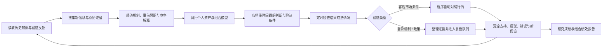

<div align="center">

# QuantItera

**开放式自主迭代量化研究引擎 · Discover. Reason. Validate. Evolve.**

[](LICENSE)
[](pyproject.toml)
[](https://github.com/wysking/quantitera/actions/workflows/ci.yml)
[](https://github.com/wysking/quantitera/releases)

*An open-source research engine that connects economic hypotheses, timestamped judgements, outcome validation, and reusable feedback — keeping your data, models, and accounts in your own private workspace.*

</div>

---

## 为什么做 QuantItera

传统回测只回答「某条规则在历史行情里赚了多少钱」，却很难回答另外三个同样关键的问题：

- **事前依据**：一个判断是在什么时间、基于哪条经济证据与市场预期提出的？
- **到期检验**：窗口成熟后，哪些部分得到了客观支持，哪些部分被反驳，哪些属于复杂机制待复盘？
- **经验复用**：下一轮研究和模型推理时，历史反驳、错误与新假设能否自动回到决策上下文？

**QuantItera** 是一个轻量、零外部服务依赖的 Python 开源研究引擎，也可以无缝接入你的 AI 研究助手（**Gemini**、**ChatGPT**、Claude 等）。它把「**证据记录 → 经济机制推理 → 事前判断归档 → 到期自动验证 → 反馈回流下一轮研究与模型**」串成一条持续演进的个人研究闭环。

## 研究如何闭环迭代



## 核心特性

| 模块 | 能力一览 |
| :--- | :--- |
| **经济机制与证据管理** | 独立记录事件、事前预期与机制证据，完整保留发布时间、首次获知时间、单位、修订记录、支持/反证、竞争解释与下一观察点 |
| **不可变判断账本** | 通过 `inbox/` 结构化请求原子处理、追加不可覆盖事件，自动生成幂等回执（`outbox/`）并按 `review_at` 登记验证任务 |
| **自动化到期验证** | 市场类判断在标的、币种、口径与完整交易窗口匹配后自动验证收盘收益或点位阈值；复杂机制与政策类判断保留证据缺口，交由研究者与 AI 助手深度复盘 |
| **知识回流与模型反馈** | 每次 `discuss` 先推进到期检查，再把本资产及全局（`all`）历史复盘送回下一轮研究与个人模型，历史观点迭代后复盘经验仍可检索 |
| **可插拔个人模型接口** | 通过极简 `provider` 协议接入你自己的资产模型、策略代码与组合模型，显式注入研究反馈并追踪反馈版本一致性 |
| **双轨成绩体系** | **研究成绩**（按资产、期限与模型版本统计原判断、复盘、前向观察与机制进展）与 **组合实盘绩效**（支持资金流、分红、费用、汇率、TWR 与基准对比）分离计量 |
| **开箱即用的私有自动化** | 内置空白工作空间模板、通用 AI 助手协作协议（`AI_WORKFLOW.md`）与 GitHub Actions 串行定时工作流，开箱部署即跑 |

> 更多模块拆解与设计细节见 [架构说明](docs/architecture.md) 与 [研究方法论](docs/research-method.md)。

## 5 分钟快速上手

需要 **Git** 与 **Python 3.12+**。

### 1. 安装并初始化个人工作空间

```sh
git clone --branch v0.5.0 https://github.com/wysking/quantitera.git
cd quantitera
python -m pip install -e .

# 初始化一个干净的私有研究工作空间
python -m research_engine init --workspace ../my-research
python -m research_engine refresh --workspace ../my-research
python -m research_engine discuss --workspace ../my-research --asset my_asset
```

接下来可按 [新用户使用指南](docs/getting-started.md) 添加自己的研究标的、行情输入与模型接口。

### 2. 运行端到端完整示例

内置两个开箱可跑的端到端示例（使用合成数据，便于直接体验完整链路）：

```sh
# 示例 1：经济证据 → 市场判断 → 复杂复盘 → 下一轮反馈 → 资产/组合模型联动
python -m examples.research_demo --workspace ../quantitera-tutorial

# 示例 2：含出入金与费用的账户时间加权收益（TWR）与风险统计
python -m examples.performance_demo --workspace ../quantitera-performance-demo
```

### 3. 直接预览生成报告

| 示例报告 | 仓库内预览 | 运行后本地路径 |
| :--- | :--- | :--- |
| 经济机制、验证与下一轮反馈 | [研究闭环示例](examples/research/research_report.md) · [JSON 结果](examples/research/summary.json) | `exports/tutorial/` |
| 长期研究成绩统计 | [研究成绩示例](examples/research/research_performance.md) | `exports/research_performance.md` |
| 账户绩效展示口径 | [账户绩效示例](examples/performance/live_portfolio_performance.md) | `exports/live_portfolio_performance.md` |
| 可选脱敏分享摘要 | [公开摘要示例](examples/performance/shareable/live_portfolio_performance.md) | `exports/shareable/` |

> 完整统计口径与可选分享配置（默认关闭，仅本地生成）见 [成绩报告说明](docs/performance.md)。

## 接入你的模型与 AI 工作流

QuantItera 采用 **「公开引擎 + 私有工作空间」** 的清晰分层：公开仓库负责通用研究内核，你的个人行情、资产模型、策略逻辑、研究记录与真实账户数据全部留在自己的私有工作空间中。

### 接入个人模型（`provider` 接口）

在个人工作空间的 `config/research.json` 中声明一个本地 Python 入口：

```json
{
  "schema_version": 1,
  "mechanisms": {},
  "provider": "my_models:provide"
}
```

实现 `provide(workspace, clock, operation, **kwargs)` 即可让资产模型与组合模型实时获取对应资产及全局验证反馈。详细契约与存量系统迁移方案见 [模型与工作空间接口](docs/providers.md)。

### 搭配 AI 助手与云端定时运行

1. **AI 助手协作**：工作空间内置通用协议 [AI_WORKFLOW.md](research_engine/workspace_template/AI_WORKFLOW.md)（同时兼容 `CHATGPT_WORKFLOW.md`），支持 **Gemini**、**ChatGPT** 等助手先读历史反馈、共同推演机制，再将新判断以结构化 JSON 写入 `inbox/`。
2. **GitHub Actions 自动刷新**：将初始化后的工作空间推送到你的**私有 GitHub 仓库** `main` 分支，内置模板 [.github/workflows/research.yml](research_engine/workspace_template/.github/workflows/research.yml) 会自动串行消费 `inbox/`、推进到期验证并更新知识索引与绩效报告。详见 [自动刷新指南](docs/automation.md)。

## 开发与测试

```sh
python -m pip install -e '.[test]'
python -m pytest -q
```

GitHub Actions 会自动在全新环境中运行全套单元测试、wheel 安装验证以及端到端示例。

## 文档导航

- [新用户使用指南](docs/getting-started.md) — 从零搭建个人研究工作空间的 10 步流程
- [架构说明](docs/architecture.md) — 核心模块职责与一条判断的完整生命周期
- [研究方法论](docs/research-method.md) — 经济机制、事前预期与复盘设计思路
- [模型与工作空间接口](docs/providers.md) — 接入自有模型、策略与存量账本
- [自动刷新指南](docs/automation.md) — 私有仓库 Actions 定时刷新配置
- [成绩报告说明](docs/performance.md) — 研究成绩与实盘绩效的计算口径
- [版本说明](docs/release-v0.5.0.md) · [更新日志](CHANGELOG.md) · [贡献指南](CONTRIBUTING.md) · [来源与迁移边界](docs/reuse.md)

## 设计定位

QuantItera 专注做好**研究记录、机制追踪、客观验证与经验回流**这一层核心基础：它本身不包含内置行情抓取、通用回测框架或实盘下单模块，交易日历默认覆盖至 2026 年并支持按需扩展。

[MIT License](LICENSE) © QuantItera Contributors
