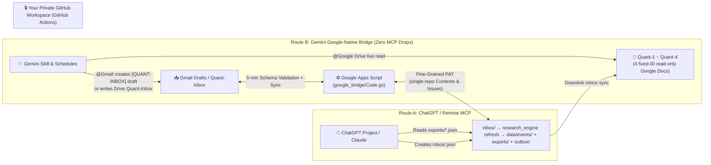

# QuantItera Dual-Track AI Integration & Google-Native Bridge Guide

[🇺🇸 English](ai-integration.en.md) | [🇨🇳 中文](ai-integration.md) | [⬅️ Back to README](../README.en.md)

One of QuantItera's core architectural principles is: **"AI assistants handle information gathering, mechanism reasoning, and hypothesis generation; the deterministic Python engine handles immutable ledgering, automated outcome validation at maturity, and historical feedback loops."**

To connect your private research workspace seamlessly across mobile and desktop, QuantItera provides **two production-tested AI integration routes**:

<table>
<tr>
<td width="50%" valign="top">

### Route A: ChatGPT / Claude / Universal MCP
**(GitHub Connector / Custom Remote MCP → Private Repo)**

- **Best For**: ChatGPT Plus / Pro (Projects + Scheduled Tasks), Claude Desktop, Cursor, or any MCP-enabled client.
- **Read Path**: Reads `AI_WORKFLOW.md` (or `CHATGPT_WORKFLOW.md`), `exports/current_state.json`, `exports/mechanisms.json`, and `exports/review_queue.json` directly from your private repository.
- **Write Path**: Commits structured JSON requests to `inbox/<request_id>.json`; GitHub Actions serially processes them and emits `outbox/<request_id>.json` receipts.

</td>
<td width="50%" valign="top">

### Route B: Gemini Google-Native Bridge ⭐
**(Google Drive / Gmail + Apps Script → GitHub Actions)**

- **Best For**: Gemini (Google AI Pro / Workspace) Skills (Gems) and Scheduled Tasks.
- **Key Advantage**: **Eliminates third-party remote MCP disconnections, 7-day OAuth token expirations, and background scheduled task write failures.**
- **How It Works**: Gemini interacts exclusively with first-party Google connectors (`@Google Drive` to read 4 read-only mirror Docs, `@Gmail` to create `[QUANT-INBOX]` drafts or write to Drive Inbox); your self-hosted **Google Apps Script** (100% free, zero GCP billing, zero public web endpoint) runs every 5 minutes, validates schemas offline, and pushes immutably to the GitHub REST API.

</td>
</tr>
</table>

---

## 🔄 Dual-Track Architecture Diagram



---

## 🅰️ Route A: ChatGPT (Projects + Scheduled Tasks) / Universal MCP Setup

### 1. Workspace Protocol Entrypoints
Every workspace initialized via `python -m research_engine init --workspace ../my-research` includes:
- [AI_WORKFLOW.md](../research_engine/workspace_template/AI_WORKFLOW.md) (universal AI assistant contract)
- [CHATGPT_WORKFLOW.md](../research_engine/workspace_template/CHATGPT_WORKFLOW.md) (backward-compatible entrypoint)

### 2. Copy-Ready ChatGPT Project Instructions

Create a ChatGPT Project, connect your private GitHub workspace repository (or remote GitHub MCP `https://api.githubcopilot.com/mcp/`), and paste:

```markdown
# QuantItera Research Workspace Instructions

This is the unified entrypoint for discussing all research assets. Before any formal discussion, read `AI_WORKFLOW.md` (or `CHATGPT_WORKFLOW.md`) from the connected private GitHub repository and follow its latest protocol; do not rely on stale chat memory.

1. **Read Historical Feedback First**:
   - Read `exports/manifest.json`, `exports/current_state.json` (including `review_feedback` for the target asset and `all`), and `exports/mechanisms.json`.
   - Separate verified facts, prior expectations, user hypotheses, and model inferences; never ignore previously `refuted` judgements or evidence gaps.
2. **Structured Archiving (Never edit `data/` or `exports/` directly)**:
   - To archive a formal judgement, create `inbox/<unique_id>.json` (`{"version":1,"operation":"save_decision","inputs":{...}}`) on the default branch with `reference`, `asset`, `record_kind="research"`, `conclusion`, `review_at`, and `review_spec`.
   - Use `record_review` for mature review tasks and `record_evidence` for economic evidence.
3. **Receipt Verification**:
   - Check `outbox/<same_id>.json`; a request is only committed when `status == "succeeded"`. If `rejected`, explain the error and resubmit under a new ID.
4. **Output Order**:
   - ① Ledger & market data cutoff dates → ② Prior judgements & review feedback → ③ New evidence (with source & publication timestamps) → ④ Economic mechanism & model view → ⑤ Independent judgement & disagreements → ⑥ Conclusion & submitted `request_id` → ⑦ Invalidation conditions & next observations.
```

---

## 🅱️ Route B: Gemini Google-Native Bridge (Google Drive / Gmail + Apps Script)

### 1. Auto-Provisioned Google Drive Layout

When `initializeAndTest()` runs for the first time, it automatically provisions **`QuantItera-Cloud/`** in your Google Drive root and binds fixed Document IDs (subsequent syncs update content in place via `Drive.Files.update`, preserving File IDs forever):

| Name | Type | Purpose | Access Rule |
| :--- | :--- | :--- | :--- |
| `Quant-1-协议与指令` | Google Doc | Synced from repository workflow protocols (`AI_WORKFLOW.md`) | Read-only mirror |
| `Quant-2-核心状态与最新回执` | Google Doc | Synced from core state (`manifest.json`, `current_state.json`, recent `outbox/` receipts) | Read-only mirror |
| `Quant-3-研究报告与个人闭环` | Google Doc | Synced from research reports, track records (`research_performance.md`), and `review_queue.json` | Read-only mirror |
| `Quant-4-同步日志与回执` | Google Doc | Real-time Apps Script uplink/downlink logs, `outbox` confirmations, and validation errors | Read-only log |
| `Quant-Inbox/` | Folder | Uplink channel: drop Google Docs / `.json` / `.md` / `.txt` / Sheets containing JSON envelopes | Writable |
| `Quant-Inbox-Queue` | Google Doc | Uplink channel: append JSON below `--- PENDING REQUESTS BELOW ---` (auto-cleared after sync) | Writable |
| `Quant-Processed/` | Folder | Historical archive of Drive requests successfully pushed to GitHub | Auto-archived |
| `Quant-Rejected/` | Folder | Requests rejected by local schema validation (annotated with error reasons) | Auto-archived |

> **Gmail Draft / Message Channel Enabled by Default**: Any **Gmail Draft** or **Message** whose subject starts with `[QUANT-INBOX]` is automatically picked up every 5 minutes, validated against QuantItera's schema, and pushed to GitHub. Successfully synced drafts are deleted (or labeled `quant-synced`); invalid drafts are renamed `[QUANT-REJECTED]` with the exact validation error prepended.

---

### 2. 5-Minute One-Time Deployment

1. **Create a Single-Repo GitHub Fine-Grained PAT**:
   - Go to GitHub → **Settings** → **Developer settings** → **Personal access tokens** → **Fine-grained tokens**.
   - Select **Only select repositories** → pick your private workspace repo (`your-username/my-quantitera-workspace`).
   - Grant **Contents: Read and write** and **Issues: Read-only** (leave all other permissions as `No access`).
2. **Create the Google Apps Script Project (Source Included in This Repo)**:
   - Open [https://script.google.com](https://script.google.com) → **New project** (`QuantItera-Bridge`).
   - Copy **[google_bridge/Code.gs](../google_bridge/Code.gs)** into `Code.gs` and **[google_bridge/appsscript.json](../google_bridge/appsscript.json)** into `appsscript.json`, and enable the **Drive API (v3)** service.
3. **Set Script Properties**:
   - In **Project Settings → Script Properties**, add:
     - `GITHUB_TOKEN` = your `github_pat_...`
     - `GITHUB_REPO` = `your-username/my-quantitera-workspace`
     - `NOTIFY_EMAIL` = optional alert email for rejected requests
4. **Run Self-Test & Install 5-Minute Trigger**:
   - Run **`initializeAndTest`** once from the editor toolbar to authorize and verify Drive/GitHub connectivity.
   - Run **`installTriggers`** once to install the single 5-minute time-driven trigger for `runBridgeCycle`.

---

### 3. Standard JSON Envelope Format

```json
{
  "target": "inbox",
  "request_id": "chat-20261121-120000-a1b2c3",
  "payload": {
    "version": 1,
    "operation": "save_decision",
    "inputs": {
      "reference": "decision-20261121-macro-01",
      "asset": "sample_growth",
      "record_kind": "research",
      "conclusion": "Maintain observation; wait for next funding-cost and capex disclosure window.",
      "review_at": "2026-11-28",
      "review_spec": "{\"kind\":\"research\",\"mechanisms\":[\"financing_channel\"],\"evidence_gaps\":[\"independent_mediator_missing\"]}"
    }
  }
}
```

---

### 4. Copy-Ready Gemini Skill (Gem) & Scheduled Task Templates

Ensure **Google Workspace** is toggled ON at `https://gemini.google.com/apps`, then paste the Skill instructions and Scheduled Task prompts from [docs/ai-integration.md](ai-integration.md) so Gemini reads `Quant-1` ~ `Quant-4` via `@Google Drive` and writes structured `[QUANT-INBOX]` drafts via `@Gmail`.
