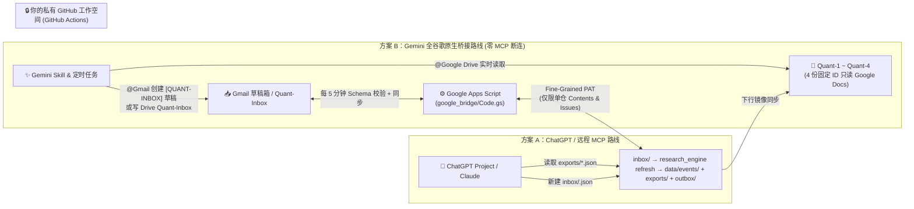

# QuantItera 双轨 AI 接入与全谷歌原生桥接指南

[🇨🇳 中文](ai-integration.md) | [🇺🇸 English](ai-integration.en.md) | [⬅️ 返回主页 README](../README.md)

QuantItera 的核心设计之一是 **「AI 助手负责搜集信息、推演机制与提出判断，确定性 Python 引擎负责不可变记账、到期客观验证与历史反馈回流」**。

为了让你的私有研究工作空间（Private GitHub Workspace）在手机和桌面上都能丝滑接入主流大模型，本项目提供 **两套经过实战验证的 AI 接入方案**：

<table>
<tr>
<td width="50%" valign="top">

### 方案 A：ChatGPT / Claude / 通用 MCP 路线
**（GitHub 插件 / 自定义远程 MCP → 私有仓库）**

- **适用对象**：ChatGPT Plus / Pro（Projects + Scheduled Tasks）、Claude Desktop、Cursor 或任何支持 GitHub Connector / MCP 的客户端。
- **读取方式**：直接读取私有工作空间中的 `AI_WORKFLOW.md`（或 `CHATGPT_WORKFLOW.md`）、`exports/current_state.json`、`exports/mechanisms.json` 与 `exports/review_queue.json`。
- **写入方式**：在 `inbox/<request_id>.json` 新建结构化判断或复盘请求，由 GitHub Actions 自动串行消费并输出 `outbox/<request_id>.json` 回执。

</td>
<td width="50%" valign="top">

### 方案 B：Gemini 全谷歌原生桥接路线 ⭐
**（Google Drive / Gmail + Apps Script → GitHub Actions）**

- **适用对象**：Gemini（Google AI Pro / Workspace）Skills（Gems）与 Scheduled Tasks（定时任务）。
- **核心优势**：**彻底告别第三方远程 MCP 断连、7 天 OAuth 过期或后台定时任务写不上 GitHub 的痛点**。
- **工作原理**：Gemini 全程只调用 Google 第一方原生连接器（`@Google Drive` 读 4 份只读镜像 Docs，`@Gmail` 写 `[QUANT-INBOX]` 草稿或写 Drive 收件箱）；个人账号托管的 **Google Apps Script**（完全免费、零 GCP 绑卡、零公网暴露面）每 5 分钟自动完成本地 Schema 强校验并单向推入 GitHub REST API。

</td>
</tr>
</table>

---

## 🔄 双轨接入架构全景图



---

## 🅰️ 方案 A：ChatGPT（Projects + Scheduled Tasks）/ 通用 MCP 配置

### 1. 仓库协议入口
用 `python -m research_engine init --workspace ../my-research` 初始化私有工作空间后，根目录自带：
- [AI_WORKFLOW.md](../research_engine/workspace_template/AI_WORKFLOW.md)（通用 AI 助手协议）
- [CHATGPT_WORKFLOW.md](../research_engine/workspace_template/CHATGPT_WORKFLOW.md)（向后兼容入口）

### 2. ChatGPT Project 指令模板（可直接复制）

在 ChatGPT 中创建一个 Project（如 `QuantItera 投研空间`），连接你的私有 GitHub 仓库（或配置远程 GitHub MCP `https://api.githubcopilot.com/mcp/`），填入以下 Project Instructions：

```markdown
# QuantItera 投研工作空间指令

这是讨论所有研究标的的统一入口。每次正式讨论前，先通过 GitHub 连接器读取私有工作空间仓库的 `AI_WORKFLOW.md`（或 `CHATGPT_WORKFLOW.md`），严格按其协议操作；不要把旧聊天记忆当作当前状态。

1. **先读历史反馈再推演**：
   - 每次讨论先读 `exports/manifest.json`、`exports/current_state.json`（含本资产及 `all` 的 `review_feedback`）与 `exports/mechanisms.json`。
   - 明确区分已核实事实、事前预期、用户假设与模型推断；不得忽略历史被反驳（`refuted`）的判断与证据缺口。
2. **结构化归档（禁止直接改写 `data/` 或 `exports/`）**：
   - 形成正式判断后，在默认分支新建 `inbox/<唯一编号>.json`（格式：`{"version":1,"operation":"save_decision","inputs":{...}}`），必填 `reference`、`asset`、`record_kind="research"`、`conclusion`、`review_at` 与 `review_spec`。
   - 到期任务复盘使用 `record_review`，经济证据归档使用 `record_evidence`。
3. **回执核对**：
   - 提交后读取 `outbox/<同编号>.json`，只有 `status == "succeeded"` 才算正式入账；若为 `rejected`，说明原因并用新编号重提。
4. **输出顺序**：
   - ① 账本与行情截止日期 → ② 历史判断与复盘反馈 → ③ 本轮新证据（附来源与发布时间） → ④ 机制与模型观点 → ⑤ 独立判断与分歧 → ⑥ 本次结论与归档请求编号 → ⑦ 证伪条件与下次观察点。
```

### 3. ChatGPT 定时任务（Scheduled Tasks）模板

- **工作日研究简报**：
  ```text
  请检索我关注的投资标的与宏观机制的最新重要变化，输出最多 5 条新事实（每条附原始来源链接、发布时间、发生日期及报价时间）。区分已核实事实、模型推断与旧闻；若私有工作空间中有已到期（status=due）的复盘项，按 AI_WORKFLOW.md 提示我核对并归档。
  ```
- **周日复盘与对账提醒**：
  ```text
  请每周日晚上提醒我：核对私有工作空间 exports/review_queue.json 中所有到期（due）和待补证据（awaiting_evaluation）的复盘清单，更新最新数据并进入项目完成本周复盘。
  ```

---

## 🅱️ 方案 B：Gemini 全谷歌原生桥接（Google Drive / Gmail + Apps Script）

> **为什么推荐 Gemini 用户使用这套桥接？**
> 第三方远程 MCP 在网页端/移动端聊天或后台 Scheduled Tasks 中经常遇到 OAuth Token 过期、`EmbeddedResource` 内容丢失或定时任务无交互确认无法落盘的问题。通过 **Google Drive + Gmail + 个人 Google Apps Script**，Gemini 全程只调用 Google 官方第一方组件，稳定度达到 100%。

### 一、Google Drive 自动生成的目录结构

脚本首次运行 `initializeAndTest()` 时，会在你的 Google Drive 根目录自动创建 **`QuantItera-Cloud/`** 及以下固定 ID 文件（后续更新原地覆盖内容，File ID 永久不变）：

| 名称 | 类型 | 用途 | 权限约定 |
| :--- | :--- | :--- | :--- |
| `Quant-1-协议与指令` | Google Doc | 同步自仓库协议镜像（`AI_WORKFLOW.md` 等） | 只读镜像（勿手动改） |
| `Quant-2-核心状态与最新回执` | Google Doc | 同步自仓库最新状态（`manifest.json`、`current_state.json`、最新 `outbox/` 回执） | 只读镜像（勿手动改） |
| `Quant-3-研究报告与个人闭环` | Google Doc | 同步自仓库研究报告、成绩统计（`research_performance.md`）与 `review_queue.json` | 只读镜像（勿手动改） |
| `Quant-4-同步日志与回执` | Google Doc | Apps Script 每次上行/下行同步状态、`outbox` 确认结果与本地校验报错 | 只读日志（勿手动改） |
| `Quant-Inbox/` | 文件夹 | 上行通道之一：放入含 JSON 信封的 Google Doc / `.json` / `.md` / `.txt` / Sheet | 可写入 |
| `Quant-Inbox-Queue` | Google Doc | 上行通道之一：在 `--- PENDING REQUESTS BELOW ---` 下方追加 JSON，同步后自动清空并归档 | 可写入 |
| `Quant-Processed/` | 文件夹 | 已成功推入 GitHub 的 Drive 请求历史归档 | 自动归档 |
| `Quant-Rejected/` | 文件夹 | 本地 Schema 校验未通过的请求（附具体报错原因，绝不污染 GitHub） | 自动归档 |

> **Gmail 草稿/邮件通道默认同时启用**：任何主题以 `[QUANT-INBOX]` 开头的 **Gmail 草稿（Draft）** 或 **邮件**，都会被 Apps Script 每 5 分钟自动抓取、校验并推入 GitHub（成功后自动清理草稿或打上 `quant-synced` 标签；若格式有误则将草稿标题改为 `[QUANT-REJECTED]` 并在正文顶部写明报错原因）。

---

### 二、5 分钟一次性部署步骤

#### 第 1 步：生成仅限单仓的 GitHub Fine-Grained PAT
1. 打开 GitHub → **Settings** → **Developer settings** → **Personal access tokens** → **Fine-grained tokens** → **Generate new token**。
2. 最小权限配置：
   - **Repository access**：选择 **Only select repositories** → 仅勾选你的私有工作空间仓库（如 `your-username/my-quantitera-workspace`）。
   - **Repository permissions**：
     - `Contents`：**Read and write**（仅用于新建 `inbox/*.json` 与读取 `outbox/*.json`）
     - `Issues`：**Read-only**（用于读取只读镜像 Issues）
     - 其余权限全部保持 `No access`。

#### 第 2 步：部署 Google Apps Script（源码已随本仓开源）
1. 打开 [https://script.google.com](https://script.google.com) → **新建项目**（命名为 `QuantItera-Bridge`）。
2. 将本仓库的 **[google_bridge/Code.gs](../google_bridge/Code.gs)** 全文复制粘贴到编辑器 `Code.gs` 中保存。
3. 在左侧 **项目设置（齿轮图标）** 勾选「在编辑器中显示 `appsscript.json` 清单文件」，将 **[google_bridge/appsscript.json](../google_bridge/appsscript.json)** 复制粘贴进去保存，并在左侧「服务」中添加 **Drive API (v3)**。

#### 第 3 步：配置脚本属性（密钥不入代码）
在 Apps Script 左侧 **项目设置 → 脚本属性（Script Properties）** 中添加：
- `GITHUB_TOKEN` = 第 1 步生成的 `github_pat_...`
- `GITHUB_REPO` = `your-username/my-quantitera-workspace`
- `NOTIFY_EMAIL` = 你的告警邮箱（可选，校验失败或回执 `rejected` 时自动发邮件提醒）

#### 第 4 步：一键自检并挂载 5 分钟定时触发器
1. 在编辑器顶部函数下拉框选择 **`initializeAndTest`** → 点击 **运行**（首次运行按提示完成个人 Google 账号授权）。看到日志输出 `GitHub 连接正常` 与 `初始化自检通过！` 即表示 Drive 目录与 GitHub 已双向连通。
2. 函数下拉框切换为 **`installTriggers`** → 点击 **运行**，即可自动挂上唯一一条每 5 分钟运行一次 `runBridgeCycle` 的时间驱动触发器。

---

### 三、标准写入 JSON 信封格式

无论通过 **Gmail 草稿**（主题：`[QUANT-INBOX] <request_id>`）还是 **Drive `Quant-Inbox` / `Quant-Inbox-Queue`**，均使用如下标准 JSON 信封：

```json
{
  "target": "inbox",
  "request_id": "chat-20261121-120000-a1b2c3",
  "payload": {
    "version": 1,
    "operation": "save_decision",
    "inputs": {
      "reference": "decision-20261121-macro-01",
      "asset": "sample_growth",
      "record_kind": "research",
      "conclusion": "维持观察，等待下一观察窗口的融资成本与投资增速数据验证。",
      "review_at": "2026-11-28",
      "review_spec": "{\"kind\":\"research\",\"mechanisms\":[\"financing_channel\"],\"evidence_gaps\":[\"independent_mediator_missing\"]}"
    }
  }
}
```

> 支持单仓直接落地（`target: "inbox"`）或主从双层工作空间（`target: "workspace/inbox"`）。`Code.gs` 内置完整的离线 Schema 校验器，在推送 GitHub 前会自动拦截中文弯引号 `“”`、非法字段名或重复 `request_id`。

---

### 四、可直接复制的 Gemini Skill（Gem）指令模板

在 `https://gemini.google.com/apps` 确保开启 **Google Workspace** 开关后，创建一个名为 `量化投资`（或 `quant-research-ledger`）的 Skill / Gem，粘贴以下通用指令：

````markdown
# QuantItera 量化研究技能指令（全谷歌原生桥接版）

这是讨论所有研究资产与验证闭环的统一入口。全程只使用 Google 原生连接器（`@Google Drive`、`@Gmail`、Google 搜索 / Google Finance），不要调用第三方 GitHub MCP 连接器。

## 1. 只读状态读取（每次讨论通过 `@Google Drive` 实时读取 `QuantItera-Cloud` 下的 4 份 Google Docs）
- **`Quant-1-协议与指令`**：工作空间最新 `AI_WORKFLOW.md` 字段规范与白名单。
- **`Quant-2-核心状态与最新回执`**：`manifest.json`、`current_state.json`（含历史 `supported`/`refuted` 复盘反馈）及最新 `outbox` 处理回执。
- **`Quant-3-研究报告与个人闭环`**：研究成绩（`research_performance.md`）、组合实盘绩效（`live_portfolio_performance.md`）与 `review_queue` 待复盘队列。
- **`Quant-4-同步日志与回执`**：Apps Script 最近一次上行/下行同步状态与校验结果。
- **严禁**手动修改 `Quant-1` ~ `Quant-4`；读取前先核对文档顶部的“最后同步时间（北京时间）”。

## 2. 结构化判断与复盘归档（通过 `@Gmail` 创建草稿）
- 需要归档新判断（`save_decision`）、到期复盘（`record_review`）或经济证据（`record_evidence`）时，调用 `@Gmail` 创建一封主题为 `[QUANT-INBOX] <唯一request_id>` 的**草稿**（保留在草稿箱即可，无需发送），正文仅写入标准 JSON 信封代码块：
  ```json
  {
    "target": "inbox",
    "request_id": "chat-YYYYMMDD-HHMMSS-随机6位",
    "payload": {
      "version": 1,
      "operation": "save_decision",
      "inputs": {
        "reference": "decision-YYYYMMDD-01",
        "asset": "标的代号",
        "record_kind": "research",
        "conclusion": "核心判断结论",
        "review_at": "YYYY-MM-DD",
        "review_spec": "{\"kind\":\"research\",\"mechanisms\":[...],\"evidence_gaps\":[...]}"
      }
    }
  }
  ```
- 严格使用英文标准双引号 `"`；投递后 Apps Script 会在 5 分钟内自动校验、推入 GitHub 并把 `outbox` 回执更新回 `Quant-4` 与 `Quant-2`。

## 3. 输出顺序
1. 账本与行情截止日期（含 `Quant-2` 最后同步时间）
2. 历史判断与复盘反馈（支持/反驳/错误/缺口）
3. 本轮新证据（附原始来源、发布时间与报价时间）
4. 经济机制与模型观点
5. 独立判断与分歧
6. 本次结论（及已投递的 `request_id` 与投递通道）
7. 证伪条件与下次观察事项
````

---

### 五、可直接复制的 Gemini 定时任务（Scheduled Tasks）模板

#### 0. 上线 5 分钟冒烟测试（验证通道后删除）
```text
请执行一次桥接冒烟测试（不要调用任何 GitHub MCP）：
1. 用 @Google Drive 读取 QuantItera-Cloud 目录下的 Quant-2-核心状态与最新回执，报出文档顶部的最后同步时间。
2. 用 @Gmail 创建一封草稿，主题为：[QUANT-INBOX] bridge-smoke-YYYYMMDD-HHMM（替换为当前北京时间），正文仅输出以下 JSON 代码块（将 request_id 同步替换为同一编号）：
{"target":"inbox","request_id":"bridge-smoke-YYYYMMDD-HHMM","payload":{"version":1,"operation":"status","inputs":{}}}
```

#### 1. 工作日 12:00：日常研究简报与到期复盘检查
```text
请每周一到周五北京时间 12:00 执行日常量化研究简报（严禁调用任何 GitHub MCP）：
1. 通过 @Google Drive 实时读取 QuantItera-Cloud 下的 Quant-2-核心状态与最新回执 与 Quant-3-研究报告与个人闭环，确认模型行情截止日及当前到期复盘项（status=due）。
2. 通过 Google 搜索与 Google Finance 检索核心关注标的与宏观机制的重要变化，输出最多 5 条新事实，每条附原始来源链接、发布时间、发生日期及行情报价时间。
3. 区分已核实事实、模型推断与旧闻；若发现有已到期的复盘项且有明确新证据，在简报末尾列出建议的复盘结论。
4. 若仅有常规观察则直接输出简报；若发现需要正式留存的高价值研究结论或新证据，读取 Quant-1-协议与指令 确认字段白名单，并用 @Gmail 创建主题为 [QUANT-INBOX] sched-YYYYMMDD-1200 的草稿写入标准 JSON 信封。
```

#### 2. 周日 20:00：周度复盘与同步健康核对
```text
请每周日北京时间 20:00 执行周度核对提醒（严禁调用任何 GitHub MCP）：
1. 通过 @Google Drive 读取 QuantItera-Cloud 下的 Quant-2-核心状态与最新回执、Quant-3-研究报告与个人闭环 与 Quant-4-同步日志与回执。
2. 汇总列出：
   - 当前所有到期（status=due）和待补证据（status=awaiting_evaluation）的复盘清单；
   - Quant-4 中本周是否有任何校验失败或被拒绝（rejected）的同步请求。
3. 提醒我开始本周复盘，不要自动编造任何记录。
```
