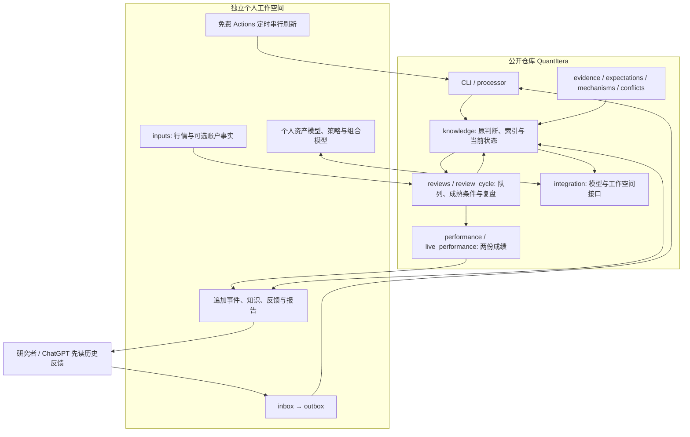

# 结构与研究循环

QuantItera 是本地 Python 包和文件工作空间。文件、请求、模型调用和串行定时流程已能完成循环，无需服务端、数据库或消息总线。

## 文件与职责

| 位置 | 作用 |
| --- | --- |
| workspace.py / processor.py | 事件追加、临时副本验证、幂等回执、统一刷新 |
| knowledge.py | 判断规范化、分类、替代关系、检索和研究入口 |
| reviews.py / review_cycle.py | 同一原判断的到期任务、结果对照、缺证据状态和反馈 |
| evidence.py / expectations.py | 原始证据、版本、获知边界及事前预期对照 |
| mechanisms.py / conflicts.py | 按期限组织机制、支持/反证、竞争解释及冲突 |
| identity.py / calendar.py / market_data.py | 标的、口径、完整交易窗口与价格可获知时间 |
| integration.py | 可选 provider；调用自己的历史、资产模型和组合模型 |
| performance.py / live_performance.py | 研究统计、真实资金流调整计算、明确缺口及可选摘要 |
| research_engine/workspace_template/ | 空白工作空间、ChatGPT 入口与私人 Actions 模板 |
| examples/ | 纯合成教程、模型和可阅读报告 |
| tests/ | 公共算法回归、真实 CLI、工作空间/模型契约和端到端测试 |

Python 模块均位于 research_engine/。没有个人模型副本或第二个事件/因子系统。

## 一条判断的生命周期

1. 研究入口读取本资产与 all 通用反馈，核实新信息、机制和竞争解释。
2. 研究者形成判断并保存 save_decision 请求。processor 在临时副本中验证，成功后追加原事件并发布回执。
3. review_at 与 review_spec 进入原队列。refresh 和 discuss 复用同一成熟检查。
4. 完整市场窗口可以支持/反驳原条件；经济机制和政策保留适用范围、缺口及人工评价。
5. 程序验证或 record_review 追加复盘事件。完成项不重复关闭；缺资料的项可以继续追加证据，旧记录不覆盖。
6. current_state.review_feedback、discuss 和模型 research_context 自动读取结果，下一判断引用经验。
7. 两份成绩从这些事件与原账户事实重建。历史回测、代理观察、模拟和实盘分别处理。

## 个人代码如何接入

provider 是显式配置、可导入的本地 Python 函数，不是自动发现的插件系统。原账户、模型、策略和因子校验由私人代码维护；引擎调用统一接口，不改模型参数。组合能取得全部资产及缺失状态。

资产与全局反馈分别传入；不同资产不会因文件名或相似标的而自动合并。source 与 feedback_revision 分别描述原数据及反馈版本。上下文更新后，旧组合结果会被标记不匹配。

引擎不连接私人示范仓库。公共 CI 使用合成 provider，已有私人工作空间的兼容验证独立进行。契约见 [providers.md](providers.md)，复用来源见 [reuse.md](reuse.md)。
