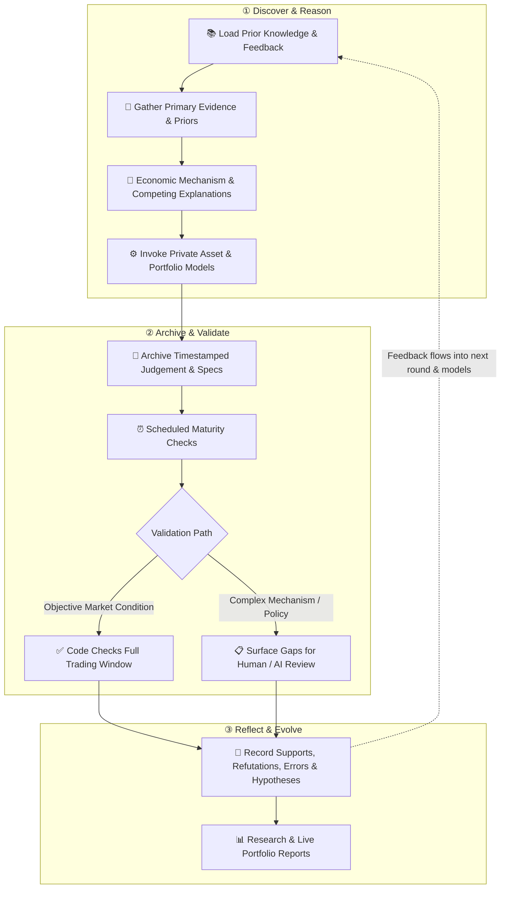

# QuantItera — Full Technical Guide

[🇺🇸 English](overview.en.md) | [🇨🇳 中文](overview.md) | [⬅️ Back to README](../README.en.md)

---

## ✨ Why QuantItera

Traditional backtesting only tells you **"how much a rule made on historical data"**, while losing the three assets that compound most in real investment research:

<table>
<tr>
<td width="33.3%" valign="top">

### 🧭 Ex-Ante Traceability
Every judgement is anchored to its **timestamp, primary evidence, prior expectation, and competing explanations** — eliminating hindsight bias and rewritten memories.

</td>
<td width="33.3%" valign="top">

### ⏱️ Automated Maturity Checks
Tracks `review_at` horizons automatically: objective market conditions are verified against market data by code, while complex mechanism and policy claims enter an explicit review queue.

</td>
<td width="33.3%" valign="top">

### 🔁 Compounding Feedback Loop
In subsequent research rounds and private model runs, historical **supports, refutations, errors, and new hypotheses** flow back into context automatically.

</td>
</tr>
</table>

> **Lightweight, Zero-Infra, Full Data Sovereignty**: QuantItera is a pure-Python open-source engine requiring no database, message broker, or server. Run it locally via CLI or pair it with **Gemini**, **ChatGPT**, or **Claude** plus a private GitHub repository for an automated closed loop.

---

## 🔄 Closed-Loop Research Lifecycle



---

## 🧩 Core Capabilities

<table>
<tr>
<td width="50%" valign="top">

#### 🔬 Economic Mechanisms & Evidence
Separately records **events, prior expectations, and mechanism evidence** while preserving publication timestamps, first-availability times, units, revisions, supporting/counter evidence, and next observations.

#### 📜 Immutable Judgement Ledger
Processes structured requests from `inbox/` atomically, appends non-overwritable events, emits idempotent receipts (`outbox/`), and schedules verification tasks by `review_at`.

#### ⚡ Automated Outcome Validation
Evaluates close returns or level thresholds once symbol, currency, return basis, and full trading sessions match; preserves evidence gaps on complex mechanisms and policy constraints for structured review.

</td>
<td width="50%" valign="top">

#### 🧠 Knowledge Feedback & Recall
Every `discuss` call advances due checks first, then returns asset-specific and global (`all`) review feedback — keeping lessons searchable even after older theses are superseded.

#### 🔌 Pluggable Private Model Interface
Expose a single local Python `provider` function to connect your asset models, strategies, and portfolio models with explicit research feedback and revision tracking.

#### 📊 Dual Track Record System
Clearly separates **Research Performance** (judgements, reviews, forward observations, and mechanism progress by asset/horizon/version) from **Live Portfolio Performance** (cash flows, dividends, fees, FX, TWR, and benchmarks).

</td>
</tr>
</table>

---

## 🚀 5-Minute Walkthrough

Requirements: **Git** + **Python 3.12+**

### 1️⃣ Install & Initialize a Private Workspace

```sh
git clone --branch v0.5.0 https://github.com/wysking/quantitera.git
cd quantitera
python -m pip install -e .

# Initialize your own clean research workspace
python -m research_engine init --workspace ../my-research
python -m research_engine refresh --workspace ../my-research
python -m research_engine discuss --workspace ../my-research --asset my_asset
```

<details>
<summary><b>📂 Click to view the initialized workspace structure</b></summary>

```text
my-research/
├── AI_WORKFLOW.md              # Universal AI assistant workflow contract (Gemini / ChatGPT)
├── config/
│   ├── research.json           # Economic mechanism hypotheses & private provider config
│   └── performance.json        # Performance reporting & optional shareable summary settings
├── inputs/
│   └── market.json             # Market histories with instrument identity & availability timestamps
├── inbox/  &  outbox/          # Structured research requests & idempotent receipts
├── data/events/                # Append-only event ledger (judgements / evidence / reviews)
├── exports/                    # Generated knowledge index, review queue, mechanism cards & reports
└── .github/workflows/
    └── research.yml            # Ready-to-use GitHub Actions serial scheduled refresh template
```

</details>

### 2️⃣ Run Two End-to-End Synthetic Demos

```sh
# Demo 1: Economic evidence → market judgements → complex review → next-round feedback → model integration
python -m examples.research_demo --workspace ../quantitera-tutorial

# Demo 2: Time-weighted return (TWR) & risk metrics with cash inflows, outflows, fees, and benchmark
python -m examples.performance_demo --workspace ../quantitera-performance-demo
```

### 3️⃣ Browse Generated Sample Reports Online

| Sample Report | Online Preview | Local Output Path |
| :--- | :--- | :--- |
| 🔬 **Closed-Loop Research Report** | [research_report.md](../examples/research/research_report.md) · [summary.json](../examples/research/summary.json) | `exports/tutorial/` |
| 🎯 **Research Track Record** | [research_performance.md](../examples/research/research_performance.md) | `exports/research_performance.md` |
| 💹 **Live Portfolio Performance** | [live_portfolio_performance.md](../examples/performance/live_portfolio_performance.md) | `exports/live_portfolio_performance.md` |
| 🌐 **Optional Shareable Summary** | [shareable/live_portfolio_performance.md](../examples/performance/shareable/live_portfolio_performance.md) | `exports/shareable/` |

---

## 🤖 Connect Your Models & AI Workflow

QuantItera separates the **Public Engine** from your **Private Workspace**: the public repository provides the core research kernel, while your market data, asset models, strategy parameters, research notes, and account records stay in your private repository.

<table>
<tr>
<td width="50%" valign="top">

### 🔌 Connect Private Models (`provider`)

Point `config/research.json` in your private workspace to your Python callable:

```json
{
  "schema_version": 1,
  "mechanisms": {},
  "provider": "my_models:provide"
}
```

Implement `provide(workspace, clock, operation, **kwargs)` to pass asset-level and global validation feedback directly into your asset and portfolio models.

👉 See [Models & Workspace Provider Contract](providers.md)

</td>
<td width="50%" valign="top">

### 🤝 Pair with AI Assistants & GitHub Actions

1. **AI Assistant Collaboration**: Point **Gemini**, **ChatGPT**, or **Claude** to [AI_WORKFLOW.md](../research_engine/workspace_template/AI_WORKFLOW.md) (compatible with `CHATGPT_WORKFLOW.md`) to read historical feedback before archiving new judgements.
2. **Unattended GitHub Actions**: Push your workspace to the `main` branch of a **private repository** — [research.yml](../research_engine/workspace_template/.github/workflows/research.yml) processes `inbox/`, advances due checks, and refreshes reports automatically.

👉 See [Automated Refresh Guide](automation.md)

</td>
</tr>
</table>

---

## 📚 Documentation Index

| Topic | Document | Description |
| :--- | :--- | :--- |
| 🚀 Getting Started | [Getting Started Guide](getting-started.md) | 10-step walkthrough from installation to a working private workspace |
| 🏗️ Architecture | [Architecture Guide](architecture.md) | Module responsibilities and the full lifecycle of a judgement |
| 🧪 Methodology | [Research Methodology](research-method.md) | Economic mechanisms, prior expectation checks, and review design |
| 🔌 Model Providers | [Provider Interface](providers.md) | Contract for connecting custom models, strategies, and existing ledgers |
| ⚙️ Automation | [Automated Refresh Guide](automation.md) | Private GitHub Actions scheduling and troubleshooting |
| 📊 Performance | [Performance Reporting](performance.md) | Calculation rules for research and live portfolio TWR / risk reports |
| 📦 Release & Reuse | [v0.5.0 Release Notes](release-v0.5.0.md) · [Changelog](../CHANGELOG.md) · [Contributing](../CONTRIBUTING.md) | Release verification, [provenance & boundaries](reuse.md), and contribution guide |

---

## 🛠️ Development & Testing

```sh
python -m pip install -e '.[test]'
python -m pytest -q
```

> **Design Scope**: QuantItera focuses on **research recording, mechanism tracking, objective outcome validation, and feedback loops**. Market data ingestion, general backtesting, and order execution can be composed freely in your private workspace. Built-in trading calendars cover through 2026 and are extensible.
