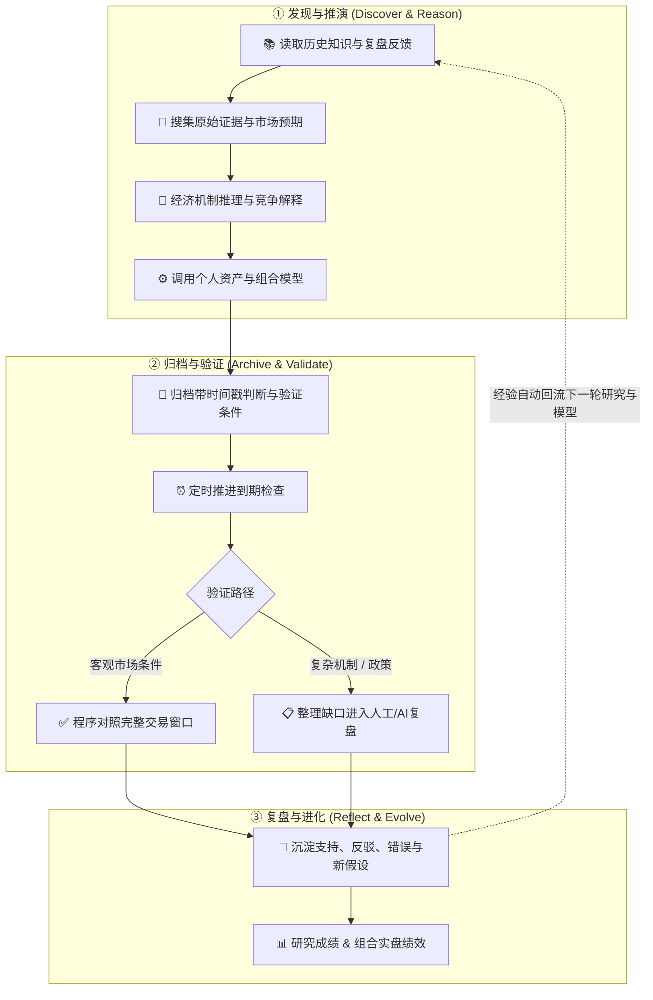

# QuantItera 完整技术指南（Full Technical Guide）

[🇨🇳 中文](overview.md) | [🇺🇸 English](overview.en.md) | [⬅️ 返回主页 README](../README.md)

---

## ✨ 为什么选择 QuantItera

传统回测只告诉你 **「某个规则在过去赚了多少钱」**，却无法沉淀投资研究里最值钱的三件事：

<table>
<tr>
<td width="33.3%" valign="top">

### 🧭 事前可追溯
每一条判断都绑定**提出时间、原始证据、事前预期与竞争解释**，彻底告别事后诸葛亮与“改写记忆”。

</td>
<td width="33.3%" valign="top">

### ⏱️ 到期自动检验
按 `review_at` 自动追踪结果成熟：客观市场条件由程序对照行情验证，复杂机制与政策判断自动进入复盘队列。

</td>
<td width="33.3%" valign="top">

### 🔁 经验持续回流
下一轮研究和个人模型推理时，历史**支持、反驳、错误与新假设**自动注入上下文，让研究真正复利成长。

</td>
</tr>
</table>

> **轻量、零基建、数据主权归你**：QuantItera 是纯 Python 开源引擎，无需数据库、消息队列或云端服务器；既可本地 CLI 运行，也可直接搭配 **Gemini**、**ChatGPT**、**Claude** 等 AI 研究助手与个人私有 GitHub 仓库形成全自动闭环。

---

## 🔄 研究闭环全景



---

## 🧩 核心能力

<table>
<tr>
<td width="50%" valign="top">

#### 🔬 经济机制与证据管理
分开记录**宏观/基本面事件、事前预期与机制证据**，保留发布时间、首次获知时间、单位、修订记录、支持/反证与下一观察点。

#### 📜 不可变判断账本
通过 `inbox/` 接收结构化请求，原子校验并追加不可覆盖事件，生成幂等回执（`outbox/`），自动按 `review_at` 登记未来验证任务。

#### ⚡ 自动化到期验证
在同标的、币种、收益口径与完整交易窗口匹配后自动对照收盘收益或点位阈值；复杂经济机制与政策约束保留证据缺口，交由研究者与 AI 助手深度复盘。

</td>
<td width="50%" valign="top">

#### 🧠 知识回流与模型反馈
每次 `discuss` 先推进到期检查，再自动汇总本资产与全局（`all`）历史复盘，确保旧观点被迭代替代后，关键教训与反证仍可精准召回。

#### 🔌 可插拔个人模型接口
只需提供一个本地 Python `provider` 函数，即可接入你自己的资产模型、策略逻辑与组合模型，自动获取结构化研究反馈并追踪版本一致性。

#### 📊 双轨成绩与绩效体系
**研究成绩**（按资产、期限与模型版本追踪原判断、复盘、前向观察与机制进展）与 **组合实盘绩效**（支持出入金、分红、费用、汇率、TWR 与基准对比）清晰分离、各司其职。

</td>
</tr>
</table>

---

## 🚀 5 分钟快速上手

环境要求：**Git** + **Python 3.12+**

### 1️⃣ 安装引擎并初始化私有工作空间

```sh
git clone --branch v0.5.0 https://github.com/wysking/quantitera.git
cd quantitera
python -m pip install -e .

# 创建属于你自己的干净研究工作空间
python -m research_engine init --workspace ../my-research
python -m research_engine refresh --workspace ../my-research
python -m research_engine discuss --workspace ../my-research --asset my_asset
```

<details>
<summary><b>📂 点击查看初始化后的工作空间目录结构</b></summary>

```text
my-research/
├── AI_WORKFLOW.md              # 通用 AI 助手研究协作协议（兼容 Gemini / ChatGPT）
├── config/
│   ├── research.json           # 经济机制假设与个人模型 provider 配置
│   └── performance.json        # 成绩统计与可选脱敏摘要设置
├── inputs/
│   └── market.json             # 个人行情输入（带标的身份与可获知时间）
├── inbox/  &  outbox/          # 结构化研究请求与幂等处理回执
├── data/events/                # 不可变事件账本（判断 / 证据 / 复盘）
├── exports/                    # 自动生成的知识索引、复盘队列、机制卡片与成绩报告
└── .github/workflows/
    └── research.yml            # 私有仓库开箱即用的 GitHub Actions 串行定时刷新模板
```

</details>

### 2️⃣ 一键体验两个完整端到端示例

仓库内置合成数据示例，一条命令即可跑通完整研究闭环与账户收益计算：

```sh
# 示例 1：经济证据 → 市场判断 → 复杂复盘 → 下一轮反馈 → 资产/组合模型联动
python -m examples.research_demo --workspace ../quantitera-tutorial

# 示例 2：含出入金、费用与基准对比的时间加权收益（TWR）绩效计算
python -m examples.performance_demo --workspace ../quantitera-performance-demo
```

### 3️⃣ 无需运行，直接在线预览报告样例

| 样例类型 | 在线直览 | 本地运行生成路径 |
| :--- | :--- | :--- |
| 🔬 **研究闭环报告**（经济机制、验证与下一轮反馈） | [research_report.md](../examples/research/research_report.md) · [summary.json](../examples/research/summary.json) | `exports/tutorial/` |
| 🎯 **长期研究成绩**（支持/反驳/复盘统计） | [research_performance.md](../examples/research/research_performance.md) | `exports/research_performance.md` |
| 💹 **组合绩效报告**（资金流调整与 TWR 口径） | [live_portfolio_performance.md](../examples/performance/live_portfolio_performance.md) | `exports/live_portfolio_performance.md` |
| 🌐 **可选公开摘要**（脱敏分享视图，默认关闭） | [shareable/live_portfolio_performance.md](../examples/performance/shareable/live_portfolio_performance.md) | `exports/shareable/` |

---

## 🤖 接入自有模型与 AI 工作流

QuantItera 采用 **「公开引擎 + 私有工作空间」** 分层架构：公开仓库持续演进通用研究内核，你的个人行情、资产模型、策略参数、研究笔记与账户记录全部沉淀在自己的私有空间。

<table>
<tr>
<td width="50%" valign="top">

### 🔌 接入自有模型（`provider`）

在个人工作空间的 `config/research.json` 中指向你的 Python 模块：

```json
{
  "schema_version": 1,
  "mechanisms": {},
  "provider": "my_models:provide"
}
```

实现 `provide(workspace, clock, operation, **kwargs)` 即可把本资产与全局验证反馈直接喂给你的资产/组合模型，且无缝兼容既有账本与运行方式。

👉 查看 [模型与工作空间接口文档](providers.md)

</td>
<td width="50%" valign="top">

### 🤝 搭配 AI 助手 & 云端自动运行

1. **双轨 AI 研究协作**：
   - **ChatGPT / Claude（GitHub 插件 / MCP）**：读取工作空间内置协议 [AI_WORKFLOW.md](../research_engine/workspace_template/AI_WORKFLOW.md)（兼容 `CHATGPT_WORKFLOW.md`），先读历史反馈再归档新判断到 `inbox/`。
   - **Gemini 全谷歌原生桥接**：通过 `@Google Drive` 读 4 份只读镜像 Docs + `@Gmail` 写 `[QUANT-INBOX]` 草稿，由 **[Google Apps Script (`google_bridge/Code.gs`)](../google_bridge/Code.gs)** 每 5 分钟自动校验并同步至 GitHub，彻底告别第三方 MCP 断连。
2. **GitHub Actions 无人值守**：推送至你的**私有仓库** `main` 分支，内置模板 [research.yml](../research_engine/workspace_template/.github/workflows/research.yml) 自动串行处理 `inbox/`、检查到期任务并刷新全套报告。

👉 查看 **[双轨 AI 接入与全谷歌原生桥接指南](ai-integration.md)** · [自动刷新与部署指南](automation.md)

</td>
</tr>
</table>

---

## 📚 文档导航

| 主题 | 文档 | 说明 |
| :--- | :--- | :--- |
| 🚀 入门上手 | [新用户使用指南](getting-started.md) | 从源码安装到搭建个人工作空间的 10 步完整教程 |
| 🤖 AI 双轨接入 | [双轨 AI 接入与全谷歌原生桥接](ai-integration.md) · [Code.gs](../google_bridge/Code.gs) | ChatGPT (MCP) 与 Gemini (Drive/Gmail + Apps Script) 完整配置与源码 |
| 🏗️ 架构设计 | [架构说明](architecture.md) | 核心模块职责划分与一条判断的完整生命周期 |
| 🧪 方法体系 | [研究方法论](research-method.md) | 经济机制拆解、事前预期对照与复盘设计思路 |
| 🔌 模型扩展 | [模型与工作空间接口](providers.md) | 接入自有模型、策略代码与存量系统的完整契约 |
| ⚙️ 自动化运维 | [自动刷新指南](automation.md) | 私有 GitHub 仓库定时工作流配置与排障手册 |
| 📊 绩效口径 | [成绩报告说明](performance.md) | 研究成绩与实盘绩效（TWR / 风险 / 基准）计算说明 |
| 📦 版本与社区 | [v0.5.0 发布说明](release-v0.5.0.md) · [更新日志](../CHANGELOG.md) · [贡献指南](../CONTRIBUTING.md) | 版本演进、设计边界（[来源说明](reuse.md)）与参与贡献 |

---

## 🛠️ 本地开发与测试

```sh
python -m pip install -e '.[test]'
python -m pytest -q
```

> **设计定位**：QuantItera 专注做好**研究记录、机制追踪、客观验证与经验回流**这一层核心基础设施，保持轻量可扩展；行情接入、通用回测与交易执行由用户按需在个人工作空间中自由组合，内置交易日历覆盖至 2026 年并支持按需扩展。
